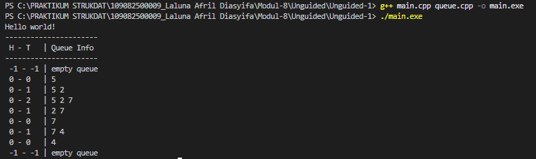
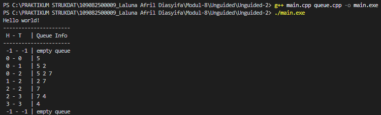
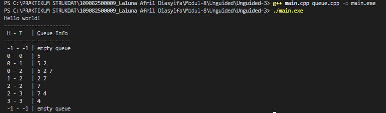

# <h1 align="center">Laporan Praktikum Modul 8 - QUEUE</h1>
<p align="center">Laluna Afril Diasyifa - 109082500009</p>

## Dasar Teori
Queue atau antrean adalah salah satu struktur data linier yang menerapkan prinsip FIFO (*First In, First Out*), yaitu elemen data yang pertama kali masuk ke dalam antrean akan menjadi elemen yang pertama kali keluar atau diproses[1]. Dalam kehidupan sehari-hari, mekanisme ini mirip dengan antrean pembelian tiket di loket kereta api, di mana orang yang datang lebih awal akan mendapatkan pelayanan terlebih dahulu dan yang datang paling akhir akan dilayani terakhir[2]. Pada struktur data queue, terdapat dua operasi utama yaitu *enqueue* (penyisipan elemen baru pada bagian belakang atau *tail*) dan *dequeue* (pengambilan atau penghapusan elemen pada bagian depan atau *head*)[1][2]. Secara umum, struktur data queue dapat diimplementasikan menggunakan representasi *pointer* (*linked list*) maupun representasi tabel (*array*)[2].

### A. Queue Representasi Pointer (*Linked List*)<br/>
Pada implementasi menggunakan *linked list*, queue disusun dari sekumpulan simpul atau elemen (*node*) yang saling terhubung secara linier melalui bantuan *pointer* (`next`) dan dikendalikan oleh dua penunjuk utama, yakni `head` dan `tail`[1][2]. Penggunaan *pointer* membuat kapasitas antrean bersifat dinamis karena alokasi memori disesuaikan secara langsung saat elemen ditambahkan atau dihapus[2].
#### 1. Struktur Data dan Inisialisasi Queue
Setiap elemen pada queue representasi *pointer* umumnya terdiri atas dua bagian, yaitu `info` untuk menyimpan nilai data dan `next` sebagai *pointer* yang menunjuk ke alamat elemen berikutnya[2]. Sementara itu, tipe bentukan *queue* menyimpan alamat `head` sebagai penunjuk elemen terdepan dan `tail` sebagai penunjuk elemen terakhir, di mana antrean dinyatakan kosong apabila penunjuknya bernilai `Nil` atau `NULL`[2].
#### 2. Mekanisme Operasi *Enqueue* dan *Dequeue*
Operasi *enqueue* dilakukan dengan mengalokasikan elemen baru terlebih dahulu, menghubungkan `next` dari elemen `tail` saat ini ke elemen baru tersebut, lalu memindahkan penunjuk `tail` ke elemen baru[2]. Sebaliknya, operasi *dequeue* dilakukan pada bagian depan dengan menyimpan alamat `head` ke variabel bantu, menggeser `head` ke elemen berikutnya (`head->next`), serta memutus hubungan *pointer* `next` pada elemen yang dikeluarkan sebelum di-dealokasi[2].
#### 3. Primitif-Primitif ADT Queue Representasi *Pointer*
Dalam pemrograman terstruktur, fungsi dan prosedur dasar queue dikemas ke dalam *Abstract Data Type* (ADT) yang dipisahkan ke dalam berkas *header* (`.h`) dan berkas implementasi (`.c`/`.cpp`)[2]. Beberapa primitif standar pada representasi ini meliputi pengecekan antrean kosong (`isEmpty`), pembuatan antrean awal (`CreateQueue`), manajemen memori (`alokasi` dan `dealokasi`), pencarian elemen (`findElm` dan `fFindElm`), penambahan serta penghapusan elemen (`insert` dan `delete`), hingga operasi penelusuran seperti `printInfo`, `nbList`, dan `delAll`[2].

### B. Queue Representasi Tabel (*Array*)<br/>
Implementasi queue menggunakan tabel atau *array* menyimpan seluruh elemen antrean di dalam blok memori yang bersebelahan dengan kapasitas maksimum yang sudah ditetapkan sejak awal[1][2]. Berbeda dengan representasi *pointer*, pendekatan ini tidak memerlukan manajemen alokasi memori dinamis, tetapi memiliki keterbatasan jumlah elemen dan membutuhkan pengelolaan pergeseran indeks `head` serta `tail` secara tepat[2].
#### 1. Alternatif 1 (*Head* Diam, *Tail* Bergerak)
Pada alternatif pertama, indeks `head` selalu dipertahankan tetap berada di posisi awal tabel selama antrean tidak kosong (misalnya bernilai `1` saat terisi dan `0` saat kosong), sedangkan indeks `tail` bergerak maju setiap kali terjadi penambahan elemen[2]. Ketika operasi *dequeue* dijalankan, elemen pada posisi `head` diambil, lalu seluruh elemen setelahnya digeser maju satu langkah ke depan dan indeks `tail` dimundurkan[2]. Cara ini merepresentasikan antrean fisik secara nyata, tetapi kurang efisien dari segi waktu komputasi karena harus melakukan pergeseran data setiap kali penghapusan[1][2].
#### 2. Alternatif 2 (*Head* Bergerak, *Tail* Bergerak)
Untuk mengatasi inefisiensi pergeseran data saat penghapusan, alternatif kedua menggerakkan indeks `head` maju ke elemen berikutnya setiap kali *dequeue* dilakukan tanpa menggeser elemen-elemen di belakangnya[2]. Meskipun lebih cepat saat penghapusan, mekanisme ini dapat memicu kondisi penuh semu, yaitu keadaan ketika `tail` sudah mencapai indeks maksimum tabel sementara di bagian depan `head` sebenarnya masih terdapat ruang kosong[2]. Apabila kondisi penuh semu terjadi saat ada penambahan elemen baru, barulah dilakukan pergeseran seluruh elemen kembali ke posisi awal tabel[2].
#### 3. Alternatif 3 (*Head* dan *Tail* Berputar / *Circular Buffer*)
Pada alternatif ketiga, indeks `head` dan `tail` dirancang bergerak memutar mengelilingi indeks tabel (*circular queue* atau *circular buffer*)[1][2]. Ketika `tail` atau `head` telah mencapai indeks maksimum tabel dan harus bergerak maju, posisinya akan kembali ke indeks awal selama masih terdapat ruang kosong yang tersedia[2]. Mekanisme berputar ini menghilangkan kebutuhan pergeseran elemen seperti pada Alternatif 1 maupun Alternatif 2 sehingga operasi penyisipan dan penghapusan berjalan jauh lebih efisien[1][2].

## Guided 1

### 1. queue.h

```C++
#ifndef QUEUE_H_INCLUDE
#define QUEUE_H_INCLUDE

#include <iostream>
using namespace std;

#define Nil NULL

typedef bool boolean;
typedef int infotype;
typedef struct elmQ *address;

struct elmQ{
   infotype info;
   address next;
};

struct queue {
   address head, tail;
};

boolean isEmpty(queue Q);
void CreateQueue(queue &Q);
address alokasi(infotype X);
void dealokasi(address P);
address findElm(queue Q, infotype X);
boolean fFindElm(queue Q, address P);
void insert(queue &Q, address P);
void deleteQueue(queue &Q, address &P);
void printInfo(queue Q);
int nbList(queue Q);
void delAll(queue &Q);

#endif
```

### 2. queue.cpp

```C++
#include "queue.h"

boolean isEmpty(queue Q) {
    return (Q.head == Nil);
}

void CreateQueue(queue &Q) {
    Q.head = Nil;
    Q.tail = Nil;
}

address alokasi(infotype X) {
    address P = new (nothrow) elmQ;
    if (P != Nil) {
        P->info = X;
        P->next = Nil;
    }
    return P;
}

void dealokasi(address P) {
    delete P;
}

address findElm(queue Q, infotype X) {
    address P = Q.head;
    while (P != Nil) {
        if (P->info == X) {
            return P;
        }
        P = P->next;
    }
    return Nil;
}

boolean fFindElm(queue Q, address P) {
    address R = Q.head;
    while (R != Nil) {
        if (R == P) {
            return true;
        }
        R = R->next;
    }
    return false;
}

void insert(queue &Q, address P) { //enqueue
    if (isEmpty(Q)) {
        Q.head = P;
        Q.tail = P;
    } else {
        (Q.tail)->next = P;
        Q.tail = P;
    }
}

void deleteQueue(queue &Q, address &P) { //dequeue
    P = Q.head;
    if (Q.head == Q.tail) {
        Q.head = Nil;
        Q.tail = Nil;
    } else {
        Q.head = P->next;
    }
    P->next = Nil;
}

void printInfo(queue Q) {
    if (isEmpty(Q)) {
        cout << "Queue kosong" << endl;
    } else {
        address P = Q.head;
        while (P != Nil) {
            cout << P->info << " ";
            P = P->next;
        }
        cout << endl;
    }
}

int nbList(queue Q) {
    int jumlah = 0;
    address P = Q.head;
    while (P != Nil) {
        jumlah++;
        P = P->next;
    }
    return jumlah;
}

void delAll(queue &Q) {
    address P;
    while (!isEmpty(Q)) {
        deleteQueue(Q, P);
        dealokasi(P);
    }
}
```

### 3. main.cpp

```C++
#include <iostream>
#include "queue.h"
using namespace std;

int main() {
    queue Q;
    address P; 

    CreateQueue(Q);
    cout << "isEmpty : " << isEmpty(Q) << endl;
    printInfo(Q);

    insert(Q, alokasi(5));
    insert(Q, alokasi(2));
    insert(Q, alokasi(7));
    cout << "Setelah insert 5, 2, 7" << endl;
    printInfo(Q);
    cout << "nbList  : " << nbList(Q) << endl;

    P = findElm(Q, 2);
    if (P != Nil) {
        cout << "findElm(2) ketemu, info = " << P->info << endl;
        cout << "fFindElm : " << fFindElm(Q, P) << endl;
    }
    if (findElm(Q, 9) == Nil) {
        cout << "findElm(9) tidak ketemu" << endl;
    }

    deleteQueue(Q, P);
    cout << "Setelah delete, elemen yang keluar = " << P->info << endl;
    dealokasi(P);
    printInfo(Q);

    delAll(Q);
    cout << "Setelah delAll" << endl;
    printInfo(Q);
    cout << "isEmpty : " << isEmpty(Q) << endl;

    return 0;
}
```
Program Guided 1 mengimplementasikan ADT Queue berbasis pointer (linked list) dengan penunjuk head dan tail yang menerapkan prinsip FIFO, lengkap dengan operasi enqueue dan dequeue, manajemen memori, pencarian, serta fungsi pendukung yang diuji di main.cpp.

## Guided 2

### 1. queue-array.h

```C++
#ifndef QUEUE_H
#define QUEUE_H

#include <iostream>
using namespace std;

const int MAKSIMAL = 5;

struct queue {
    string nama[MAKSIMAL];
    int head;
    int tail;
};

bool isFull(queue Q);
bool isEmpty(queue Q);
void CreateQueue(queue &Q);
void enQueue(queue &Q, string nama);
void deQueue(queue &Q);
void viewQueue(queue Q);

#endif
```

### 2. queue-array.cpp

```C++
#include "queue-array.h"
#include <iostream>

using namespace std;

// NOTE : 
// Implementasi 1 = head diam, tail bergerak (Queue Linear Statis, kerana head nya tetap diam)
// Implementasi 2 = head bergerak, tail bergerak (Queue Linear Dinamis, karena head & tail nya sama-sama bergerak)
// Implementasi 3 = head dan tail berputar (Queue Circular, karena jika udh mentok tapi masih ada space, diputar sehingga tail bisa ada didepan head)

bool isEmpty(queue Q){
    if(Q.head == -1 && Q.tail == -1){
        return true;
    } else {
        return false;
    }
}

//isFull implmenetasi 1
bool isFull(queue Q){
    if(Q.tail == MAKSIMAL - 1){
        return true;
    } else {
        return false;
    }
}

// //isFull implementasi 2
// bool isFull(queue Q){
//     if(Q.head == 0 && Q.tail == MAKSIMAL - 1){
//         return true;
//     } else {
//         return false;
//     }
// }

// //isFull implementasi 3
// bool isFull(queue Q){
//     if((Q.tail + 1) % MAKSIMAL == Q.head){
//         return true;
//     } else {
//         return false;
//     }
// }

void CreateQueue(queue &Q){ //terbentuk queue dengan head = -1 dan tail = -1 
    Q.head = -1;
    Q.tail = -1;
}
 

//enqueue implementasi 1
void enQueue(queue &Q, string nama){
    if(isFull(Q) == true){
        cout << "Queue sudah penuh!" << endl;
    } else {
        if(isEmpty(Q) == true){
            Q.head = Q.tail = 0;
        } else {
            Q.tail++;
        }
        Q.nama[Q.tail] = nama;
        cout << "nama " << nama << " berhasil ditambahkan kedalam queue!" << endl;
    }
}

// //enQueue implementasi 2
// void enQueue(queue &Q, string nama){
//     if(isFull(Q) == true){
//         cout << "Queue sudah penuh!" << endl;
//     } else {
//         if(isEmpty(Q) == true){
//             Q.head = Q.tail = 0;
//         } else {
//             if(Q.tail == MAKSIMAL - 1){ // penuh semu, geser elemen ke kiri
//                 int selisih = Q.head;
//                 for(int i = Q.head; i <= Q.tail; i++){
//                     Q.nama[i - selisih] = Q.nama[i];
//                 }
//                 Q.tail = Q.tail - selisih;
//                 Q.head = 0;
//             }
//             Q.tail++;
//         }
//         Q.nama[Q.tail] = nama;
//         cout << "nama " << nama << " berhasil ditambahkan kedalam queue!" << endl;
//     }
// }

// //enQueue implementasi 3
// void enQueue(queue &Q, string nama){
//     if(isFull(Q) == true){
//         cout << "Queue sudah penuh!" << endl;
//     } else {
//         if(isEmpty(Q) == true){
//             Q.head = Q.tail = 0;
//         } else {
//             Q.tail = (Q.tail + 1) % MAKSIMAL; // bergerak melingkar
//         }
//         Q.nama[Q.tail] = nama;
//         cout << "nama " << nama << " berhasil ditambahkan kedalam queue!" << endl;
//     }
// }

//dequeue implementasi 1
void deQueue(queue &Q){
    if(isEmpty(Q) == true){
        cout << "Queue kosong!" << endl;
    } else {
        cout << "Mengahapus data " << Q.nama[Q.head] << "..." << endl;
        for(int i = 0; i < Q.tail; i++){
            Q.nama[i] =  Q.nama[i+1];
        }
        Q.tail--;
        if(Q.tail < 0){ //kalo semua isi queue nya udh dikeluarin, set head & tail ke -1
            Q.head = -1;
            Q.tail = -1;
        }
    }
}

// //dequeue implementasi 2
// void deQueue(queue &Q){
//     if(isEmpty(Q) == true){
//         cout << "Queue kosong!" << endl;
//     } else {
//         cout << "Mengahapus data " << Q.nama[Q.head] << "..." << endl;
//         Q.head++;
//         if(Q.head > Q.tail){ //kalo elemennya udh abis (head akan lebih 1 dari tail), maka reset ulang head & tail ke -1
//             Q.head = -1;
//             Q.tail = -1;
//         }
//     }
// }

// //deQueue implementasi 3
// void deQueue(queue &Q){
//     if(isEmpty(Q) == true){
//         cout << "Queue kosong!" << endl;
//     } else {
//         cout << "Mengahapus data " << Q.nama[Q.head] << "..." << endl;
//         if(Q.head == Q.tail){ //kalo elemennya tinggal 1, langsungkan saja head & tail nya reset ke -1
//             Q.head = -1;
//             Q.tail = -1;
//         } else {
//             Q.head = (Q.head + 1) % MAKSIMAL; // bergerak melingkar
//         }
//     }
// }

//viewQueue implementasi 1 & 2
void viewQueue(queue Q){
    if(isEmpty(Q) == true){
        cout << "Queue kosong!" << endl;
    } else {
        for(int i = Q.head; i <= Q.tail; i++){
            cout << i -  Q.head + 1 << ". " << Q.nama[i] << endl;
        }
    }
    cout << endl;
}

// //viewQueue implementasi 3
// void viewQueue(queue Q){
//     if(isEmpty(Q) == true){
//         cout << "Queue kosong!" << endl;
//     } else {
//         int i = Q.head;
//         int count = 1;
//         while(true){
//             cout << count << ". " << Q.nama[i] << endl;
//             if(i == Q.tail){
//                 break;
//             }
//             i = (i + 1) % MAKSIMAL;
//             count++;
//         }   
//     }
// }
```

### 3. main.cpp

```C++
#include "queue-array.h"
#include <iostream>

using namespace std;

int main(){
    queue Q;

    CreateQueue(Q);
    enQueue(Q, "Dimas");
    enQueue(Q, "Arvin");
    enQueue(Q, "Rizal");
    enQueue(Q, "Hafizh");
    enQueue(Q, "Fathur");
    enQueue(Q, "Daffa");
    cout << endl;

    cout << "--- Isi Queue Setelah enQueue ---" << endl;
    viewQueue(Q);
    cout << endl;

    deQueue(Q);
    deQueue(Q);
    deQueue(Q);
    deQueue(Q);
    // deQueue(Q);
    // deQueue(Q);
    cout << endl;

    cout << "--- Isi Queue Setelah deQueue ---" << endl;
    viewQueue(Q);

    return 0;
}
```
Program ini mengimplementasikan ADT *Queue* berbasis *array* berkapasitas tetap (`MAKSIMAL = 5`) bertipe `string` yang menyediakan tiga mekanisme antrean (*head* tetap, *head* & *tail* bergerak, serta *head* & *tail* berputar) dan diuji melalui operasi `CreateQueue`, `enQueue`, `deQueue`, serta `viewQueue` pada `main.cpp`.

## Unguided 

### 1. Buatlah ADT Queue menggunakan ARRAY sebagai berikut di dalam file “queue.h”:  
```
Type infotype: integer 
Type Queue: < 
    info : array [5] of infotype {index array dalam C++ dimulai dari 0} 
    head, tail : integer 
>
procedure CreateQueue(input/output Q: Queue) 
function isEmptyQueue(Q: Queue) → boolean
function isFullQueue(Q: Queue) → boolean
procedure enqueue (input/output Q: Queue, input x: infotype)
function dequeue (input/output Q: Queue) → infotype
procedure printInfo (input Q: Queue)
```
### Buatlah implementasi ADT Queue pada file “queue.cpp” dengan menerapkan mekanisme queue Alternatif 1 (head diam, tail bergerak).
```
int main() 
{  
    cout << "Hello world!" << endl;  
    Queue Q;  
    createQueue(Q);

    cout<<"----------------------"<<endl;
    cout<<" H - T \t | Queue info"<<endl;
    cout<<"----------------------"<<endl;
    printInfo(Q);
    enqueue(Q,5); printInfo(Q);
    enqueue(Q,2); printInfo(Q);
    enqueue(Q,7); printInfo(Q);
    dequeue(Q); printInfo(Q);
    enqueue(Q,4); printInfo(Q);
    dequeue(Q); printInfo(Q);
    dequeue(Q); printInfo(Q);

    return 0;
} 
``` 
### 1. queue.h

```C++
#ifndef QUEUE_H
#define QUEUE_H

#include <iostream>
using namespace std;

const int MAXQ = 5;
typedef int infotype;

struct Queue {
    infotype info[MAXQ];
    int head, tail;
};

void createQueue(Queue &Q);
bool isEmptyQueue(Queue Q);
bool isFullQueue(Queue Q);
void enqueue(Queue &Q, infotype x);
infotype dequeue(Queue &Q);
void printInfo(Queue Q);

#endif
```
### 2. queue.cpp

```C++
#include "queue.h"
#include <iomanip>
#include <string>

void createQueue(Queue &Q) {
    Q.head = -1;
    Q.tail = -1;
}

bool isEmptyQueue(Queue Q) {
    return Q.head == -1 && Q.tail == -1;
}

bool isFullQueue(Queue Q) {
    return Q.tail == MAXQ - 1;
}

void enqueue(Queue &Q, infotype x) {
    if (isFullQueue(Q)) {
        cout << "Queue penuh" << endl;
    } else {
        if (isEmptyQueue(Q)) {
            Q.head = 0;
            Q.tail = 0;
        } else {
            Q.tail++;
        }
        Q.info[Q.tail] = x;
    }
}

infotype dequeue(Queue &Q) {
    infotype x = -1;
    if (isEmptyQueue(Q)) {
        cout << "Queue kosong" << endl;
    } else {
        x = Q.info[Q.head];
        for (int i = Q.head; i < Q.tail; i++) {
            Q.info[i] = Q.info[i + 1];
        }
        Q.tail--;
        if (Q.tail == -1) {
            Q.head = -1;
        }
    }
    return x;
}

void printInfo(Queue Q) {
    string ht = to_string(Q.head) + " - " + to_string(Q.tail);
    cout << " " << left << setw(8) << ht << "| ";
    if (isEmptyQueue(Q)) {
        cout << "empty queue";
    } else {
        for (int i = Q.head; i <= Q.tail; i++) {
            cout << Q.info[i] << " ";
        }
    }
    cout << endl;
}
```
### 3. main.cpp

```C++
#include "queue.h"

int main() {
    cout << "Hello world!" << endl;
    Queue Q;
    createQueue(Q);

    cout << "----------------------" << endl;
    cout << " H - T   | Queue Info" << endl;
    cout << "----------------------" << endl;
    printInfo(Q);
    enqueue(Q, 5); printInfo(Q);
    enqueue(Q, 2); printInfo(Q);
    enqueue(Q, 7); printInfo(Q);
    dequeue(Q);    printInfo(Q);
    dequeue(Q);    printInfo(Q);
    enqueue(Q, 4); printInfo(Q);
    dequeue(Q);    printInfo(Q);
    dequeue(Q);    printInfo(Q);

    return 0;
}
```
### Output Unguided 1 :

##### Output 1


Program tersebut mengimplementasikan ADT Queue berbasis array berukuran 5 bertipe integer dengan mekanisme Alternatif 1 (head tetap di indeks 0 saat terisi, tail bergerak, serta menggeser elemen ke kiri saat dequeue). Melalui berkas queue.h dan queue.cpp, didefinisikan struktur Queue beserta primitif createQueue, isEmptyQueue, isFullQueue, enqueue, dequeue, dan printInfo untuk mengatur status antrean kosong (-1), menyisipkan data di belakang, mengambil elemen terdepan sambil menggeser sisa data, serta menampilkan pasangan indeks head - tail beserta isi antrean. Pada main.cpp, seluruh operasi tersebut diuji secara bertahap, dengan catatan urutan pemanggilan dequeue dan enqueue pada kode yang diberikan sedikit berbeda dari contoh soal di modul sehingga pola keluaran H - T dan isi queue akan mengikuti urutan eksekusi kode tersebut. 

### 2. Buatlah implementasi ADT Queue pada file “queue.cpp” dengan menerapkan mekanisme queue Alternatif 2 (head bergerak, tail bergerak).

### 1. queue.h
```C++
#ifndef QUEUE_H
#define QUEUE_H

#include <iostream>
using namespace std;

const int MAXQ = 5;
typedef int infotype;

struct Queue {
    infotype info[MAXQ];
    int head, tail;
};

void createQueue(Queue &Q);
bool isEmptyQueue(Queue Q);
bool isFullQueue(Queue Q);
void enqueue(Queue &Q, infotype x);
infotype dequeue(Queue &Q);
void printInfo(Queue Q);

#endif
```
### 2. queue.cpp
```C++
#include "queue.h"
#include <iomanip>
#include <string>

void createQueue(Queue &Q) {
    Q.head = -1;
    Q.tail = -1;
}

bool isEmptyQueue(Queue Q) {
    return Q.head == -1 && Q.tail == -1;
}

bool isFullQueue(Queue Q) {
    return Q.head == 0 && Q.tail == MAXQ - 1;
}

void enqueue(Queue &Q, infotype x) {
    if (isFullQueue(Q)) {
        cout << "Queue penuh" << endl;
    } else {
        if (isEmptyQueue(Q)) {
            Q.head = 0;
            Q.tail = 0;
        } else {
            if (Q.tail == MAXQ - 1) {         
                int n = Q.tail - Q.head + 1;
                for (int i = 0; i < n; i++) {
                    Q.info[i] = Q.info[Q.head + i];
                }
                Q.head = 0;
                Q.tail = n - 1;
            }
            Q.tail++;
        }
        Q.info[Q.tail] = x;
    }
}

infotype dequeue(Queue &Q) {
    infotype x = -1;
    if (isEmptyQueue(Q)) {
        cout << "Queue kosong" << endl;
    } else {
        x = Q.info[Q.head];
        if (Q.head == Q.tail) {           
            Q.head = -1;
            Q.tail = -1;
        } else {
            Q.head++;                        
        }
    }
    return x;
}

void printInfo(Queue Q) {
    string ht = to_string(Q.head) + " - " + to_string(Q.tail);
    cout << " " << left << setw(8) << ht << "| ";
    if (isEmptyQueue(Q)) {
        cout << "empty queue";
    } else {
        for (int i = Q.head; i <= Q.tail; i++) {
            cout << Q.info[i] << " ";
        }
    }
    cout << endl;
}
```
### 3. main.cpp
```C++
#include "queue.h"

int main() {
    cout << "Hello world!" << endl;
    Queue Q;
    createQueue(Q);

    cout << "----------------------" << endl;
    cout << " H - T   | Queue Info" << endl;
    cout << "----------------------" << endl;
    printInfo(Q);
    enqueue(Q, 5); printInfo(Q);
    enqueue(Q, 2); printInfo(Q);
    enqueue(Q, 7); printInfo(Q);
    dequeue(Q);    printInfo(Q);
    dequeue(Q);    printInfo(Q);
    enqueue(Q, 4); printInfo(Q);
    dequeue(Q);    printInfo(Q);
    dequeue(Q);    printInfo(Q);

    return 0;
}
```
### Output Unguided 2 :

##### Output 1


Program tersebut mengimplementasikan ADT Queue berbasis array berukuran 5 bertipe integer dengan mekanisme Alternatif 2, di mana penunjuk head dan tail sama-sama bergerak saat operasi antrean berlangsung. Melalui queue.h dan queue.cpp, dequeue cukup menggeser head maju (atau me-reset ke -1 saat elemen terakhir dihapus) tanpa menggeser sisa elemen, sedangkan enqueue menangani kondisi penuh semu dengan menggeser elemen aktif ke indeks awal jika tail sudah mencapai batas akhir array padahal antrean belum benar-benar penuh, lalu printInfo menampilkan status indeks head - tail beserta isi antrean yang diuji melalui main.cpp.

### 3. Buatlah implementasi ADT Queue pada file “queue.cpp” dengan menerapkan mekanisme queue Alternatif 3 (head dan tail berputar)

### 1. queue.h
```C++
#ifndef QUEUE_H
#define QUEUE_H

#include <iostream>
using namespace std;

const int MAXQ = 5;
typedef int infotype;

struct Queue {
    infotype info[MAXQ];
    int head, tail;
};

void createQueue(Queue &Q);
bool isEmptyQueue(Queue Q);
bool isFullQueue(Queue Q);
void enqueue(Queue &Q, infotype x);
infotype dequeue(Queue &Q);
void printInfo(Queue Q);

#endif
```
### 2. queue.cpp
```C++
#include "queue.h"
#include <iomanip>
#include <string>

void createQueue(Queue &Q) {
    Q.head = -1;
    Q.tail = -1;
}

bool isEmptyQueue(Queue Q) {
    return Q.head == -1 && Q.tail == -1;
}

bool isFullQueue(Queue Q) {
    return (Q.tail + 1) % MAXQ == Q.head;
}

void enqueue(Queue &Q, infotype x) {
    if (isFullQueue(Q)) {
        cout << "Queue penuh" << endl;
    } else {
        if (isEmptyQueue(Q)) {
            Q.head = 0;
            Q.tail = 0;
        } else {
            Q.tail = (Q.tail + 1) % MAXQ;      
        }
        Q.info[Q.tail] = x;
    }
}

infotype dequeue(Queue &Q) {
    infotype x = -1;
    if (isEmptyQueue(Q)) {
        cout << "Queue kosong" << endl;
    } else {
        x = Q.info[Q.head];
        if (Q.head == Q.tail) {                
            Q.head = -1;
            Q.tail = -1;
        } else {
            Q.head = (Q.head + 1) % MAXQ;      
        }
    }
    return x;
}

void printInfo(Queue Q) {
    string ht = to_string(Q.head) + " - " + to_string(Q.tail);
    cout << " " << left << setw(8) << ht << "| ";
    if (isEmptyQueue(Q)) {
        cout << "empty queue";
    } else {
        int i = Q.head;
        while (true) {
            cout << Q.info[i] << " ";
            if (i == Q.tail) break;
            i = (i + 1) % MAXQ;
        }
    }
    cout << endl;
}
```
### 3. main.cpp
```C++
#include "queue.h"

int main() {
    cout << "Hello world!" << endl;
    Queue Q;
    createQueue(Q);

    cout << "----------------------" << endl;
    cout << " H - T   | Queue Info" << endl;
    cout << "----------------------" << endl;
    printInfo(Q);
    enqueue(Q, 5); printInfo(Q);
    enqueue(Q, 2); printInfo(Q);
    enqueue(Q, 7); printInfo(Q);
    dequeue(Q);    printInfo(Q);
    dequeue(Q);    printInfo(Q);
    enqueue(Q, 4); printInfo(Q);
    dequeue(Q);    printInfo(Q);
    dequeue(Q);    printInfo(Q);

    return 0;
}
```
### Output Unguided 3 :

##### Output 1


Program tersebut mengimplementasikan ADT Queue berbasis array berukuran 5 bertipe integer dengan mekanisme Alternatif 3 (circular buffer), di mana indeks head dan tail berputar secara melingkar menggunakan operasi modulo (% MAXQ) saat mencapai batas akhir array. Melalui queue.h dan queue.cpp, isFullQueue mengecek kondisi penuh saat (Q.tail + 1) % MAXQ == Q.head, enqueue serta dequeue memajukan tail dan head secara melingkar tanpa perlu menggeser elemen (serta me-reset keduanya ke -1 saat elemen terakhir dihapus), dan printInfo menelusuri isi antrean dari head sampai tail secara melingkar untuk kemudian diuji melalui serangkaian operasi pada main.cpp.

## Kesimpulan
Praktikum Modul 8 membahas struktur data Queue berprinsip FIFO (First In, First Out) dengan operasi penambahan di belakang (tail) dan pengambilan di depan (head), baik melalui representasi pointer (linked list) yang dinamis maupun representasi tabel (array) berkapasitas tetap beserta ketiga mekanismenya (head tetap, head dan tail bergerak dengan penanganan penuh semu, serta head dan tail berputar secara melingkar). Melalui praktik guided dan unguided, mahasiswa dapat memahami perbedaan karakteristik tiap implementasi serta menerapkan primitif ADT queue sesuai spesifikasi yang ditetapkan.

## Referensi
Informatics Laboratory, Fakultas Informatika, Telkom University. (t.t.). Modul 8: Queue. Modul Praktikum Struktur Data.
